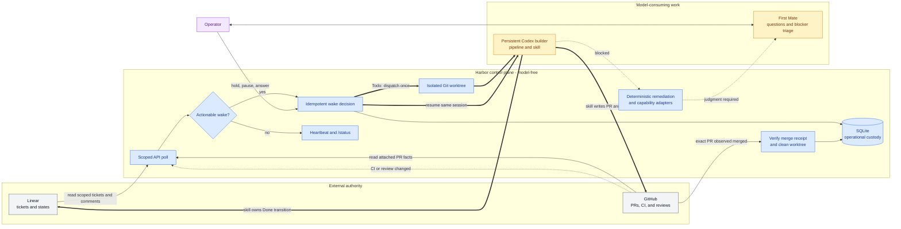

# Harbor

Harbor is a calm, deterministic supervisor for one explicitly configured
project at a time. It
polls Linear and GitHub without making model calls, persists what it sees in
SQLite, hands each ticket to the project's **work-pipeline** in an isolated
worktree, keeps the same builder session across re-engagement, and gives the
operator a First Mate console in the same terminal. First Mate also monitors
stuck runs and recovers them.

The boundary is deliberate:

> The work-pipeline decides. Harbor watches, wakes, unblocks, and reports.

`harbor init` copies the bundled work-pipeline into `<repo>/.harbor/workflow/`.
To change how tickets are delivered, edit that copy: its `skills/*.md`, its
`workflow.toml` policy and its `config.toml` models.

## Why Harbor exists

Harbor is inspired by Symphony's issue-to-workspace orchestration and
Firstmate's operator-oriented supervision. It addresses two practical
constraints in long-running delivery workflows:

- **Monitoring should be cheap.** Linear and GitHub polling, snapshot
  comparison, wake decisions, heartbeats, and status rendering are ordinary
  deterministic code. A cycle with no actionable Linear or GitHub facts does
  not invoke a model.
- **Delivery policy belongs to the project.** Planning, implementation,
  review, proof, and merge rules vary by repository. Harbor passes the selected
  pipeline document and skill to the builder instead of embedding those rules
  in the supervisor.

Builder and First Mate models, reasoning effort, polling cadence, deadline,
and merge hold are configured in Markdown. Both roles default to Codex.
Set `builder_provider: claude` or `firstmate_provider: claude` and an explicit
Claude model to use the installed Claude Code CLI. A retained builder stays
with the provider that owns its session.

To change First Mate later, edit the selected project’s pipeline: set the
`firstmate` model in the Models table (or `firstmate_model`), and set
`firstmate_provider: codex` or `firstmate_provider: claude`. Use a model ID
or alias supported by that provider’s installed CLI; Harbor passes it through
and does not automatically discover the latest version. For example, choose
`gpt-6-luna` with Codex, or a supported Claude model or alias with Claude
Code. If the workflow defines `skills.blocker_assessment.model`, that model
overrides the pipeline setting for First Mate. Restart Harbor to reload changes.

Harbor records native usage limits in its local ledger and keeps polling
Linear and GitHub. It retries on a healthy poll after the reported reset.
Without a reliable reset time, it waits 5 minutes, then 15 minutes, then
30 minutes between attempts. First Mate and the dashboard show the next
retry time. The existing crash retry budget is separate.

Instead of waiting, a project can opt in to continue on the other provider
(Codex or Claude) with a `[quota_fallback]` section in `config.toml`. A builder
stopped by a usage limit restarts in a fresh session in the same worktree, and
First Mate retries on the fallback provider. See
[Provider fallback on usage limits](docs/configurable-workflows.md#provider-fallback-on-usage-limits-quota_fallback).

On an attached open PR, a GitHub repository owner's `lgtm merge` comment
authorizes the delivery workflow to merge the head Harbor observed before the
comment. The workflow checks the remaining merge gates and updates Linear.
Harbor verifies the merge before removing the retained worktree.

## Manual multi-project setup

`harbor init` is the quickest path (see
[the work-pipeline workflow](docs/configurable-workflows.md)). Manually, each
user owns a private registry and one pipeline document per project, and each
repository needs its own copy of the work-pipeline. The checked-in
`projects.md` and `templates/pipeline.md` files are neutral format examples;
Harbor never uses them as real product configuration.

```bash
mkdir -p "$HOME/.harbor"
mkdir -p "$HOME/Pipelines"
cp templates/pipeline.md "$HOME/Pipelines/sample-project.md"
cp -R workflows/work-pipeline ~/Projects/SampleProject/.harbor/workflow
$EDITOR ~/Projects/SampleProject/.harbor/workflow/config.toml   # set [controller] model
```

Create `$HOME/.harbor/projects.md` with one row per repository:

```md
| name | repo_path | pipeline_path | linear_project_slug | linear_team | github_repository | base_branch |
| --- | --- | --- | --- | --- | --- | --- |
| SampleProject | ~/Projects/SampleProject | ~/Pipelines/sample-project.md | sample-project-abc123 | SAMPLE | example/SampleProject | main |
| AnotherProject | ~/Projects/AnotherProject | ~/Projects/AnotherProject/.harbor/pipeline.md | another-project-def456 | OTHER | example/AnotherProject | main |
```

Set credentials and select the private registry. Credentials stay in the
environment and must never be written into either Markdown file.

```bash
export HARBOR_PROJECTS_FILE="$HOME/.harbor/projects.md"
export LINEAR_API_KEY="<linear-api-key>"
export GH_TOKEN="<github-token>" # only when GitHub facts are configured
```

Each named project has separate repository, pipeline, Linear scope, GitHub
facts, worktree root, and SQLite custody. `linear_projects` widens one named
project's Linear scope; it is not a way to combine unrelated repositories or
workflows. Run one Harbor process per named repository.

## Verify and start

From the Harbor checkout:

```bash
cd ~/Projects/harbor
uv sync
uv run harbor doctor SampleProject
uv run harbor start SampleProject
```

The selected private registry resolves `SampleProject` to its repository, Linear project, GitHub
repository, base branch, and live pipeline document. `doctor` verifies the
Linear connection and that the configured project scope exists. `start` then
opens the `first-mate>` prompt, starts model-free polling, and schedules any
eligible builder dispatch in the background so the prompt remains usable
while an agent works.

Linear and GitHub API credentials are external-service credentials, not model
calls. Linear uses `LINEAR_API_KEY` or `HARBOR_LINEAR_API_KEY`; the GitHub
poller uses `GITHUB_TOKEN` or `GH_TOKEN` when GitHub facts are configured. The
builder uses the same token for its own GitHub work through Harbor's REST
helper (default) or an opt-in GitHub MCP server; see
[GitHub transport](docs/configurable-workflows.md#github-transport-github).

For a read-only one-cycle check:

```bash
uv run harbor start SampleProject --once
uv run harbor start SampleProject --shadow
uv run harbor facts SampleProject --json
uv run harbor status SampleProject --json
```

`--shadow` computes wake decisions and prints `WOULD WAKE` lines without
dispatching, queuing, or writing Linear/GitHub. `facts` performs the read-only
PR-facts query; `status` reads the local runtime ledger.

## The work-pipeline workflow

Harbor runs exactly one workflow: the project's copy of the work-pipeline in
`<repo>/.harbor/workflow/`. There are no packages or presets to choose. Edit
the copy to change the dev workflow, and inspect the effective policy with
`harbor workflow inspect`. Edits are adopted on the next builder turn, not
treated as a blocker. See [the work-pipeline workflow](docs/configurable-workflows.md)
for layout, models, recovery, the watchdog and migration from older setups.

## Local web dashboard

Add `--web` when you start your project:

```sh
uv run harbor start SampleProject --web
```

Open `http://127.0.0.1:8765/` to view ticket activity or chat with First Mate.
Use Command+Enter to send a chat message. To record decisions, open the full
launch link printed by Harbor. The dashboard listens only on loopback.
Use `--web 8766` to choose another port, for example when monitoring a second
project in another Harbor process. The selected project's registry and existing
dispatch rules apply to both interfaces.

The page refreshes ticket, builder, PR, and escalation status every five seconds
from the supervisor's current snapshot. Ask First Mate in the chat panel. Recent
turns supply context for follow-up questions and the browser clears the chat on
reload. The **Answer** button records an operator decision through the same
retained-session queue as `/answer`. Keep the Harbor terminal open while using
the page. Type `/exit` there to stop both interfaces.

## Same-terminal First Mate workflow

There is no `harbor ask` or project-name prefix for questions. Once
`harbor start SampleProject` is running, type a plain question directly. Slash
commands are deterministic and do not invoke a model; plain text sends one
question to the configured First Mate model with the detailed status digest.

```text
first-mate> /status
Harbor: RUNNING · SampleProject · Linear healthy
SAMPLE-33  In Progress  Update the README  builder running
Run details and history: /status --full

first-mate> What is the fleet waiting on?
<one Luna answer based on the refreshed fleet digest>

first-mate> /hold on SAMPLE-42
Harbor: HOLD ON · SAMPLE-42

first-mate> /hold off SAMPLE-42
Harbor: HOLD OFF · SAMPLE-42

first-mate> /pause Stopping for the evening
Harbor: PAUSED · Stopping for the evening

first-mate> /resume
Harbor: RUNNING

first-mate> /retry SAMPLE-42
Harbor: same builder retried · SAMPLE-42 · waiting

first-mate> /exit
Harbor: STOPPED
```

The commands are:

| Command | Effect |
| --- | --- |
| `/status` | Show current Linear tickets, their builder status and PR facts, and open escalations. Zero model calls. |
| `/status --full` | Include retained runs, session IDs, retry and execution details, and past outcomes. |
| `/hold on/off <ticket>` | Change the durable merge hold for exactly one observed ticket. This does not pause polling or other agents. |
| `/pause [reason]` | Pause the whole supervisor: no new dispatches or resumes; a running builder is allowed to finish and its deadline is suspended. |
| `/resume` | Re-enable dispatch/resume, restart deadline accounting, and perform a fresh poll. |
| `/answer <escalation-id> <answer>` | Record an operator decision, mark the escalation answered, and attempt to resume the retained builder session. `Citation: path:line` is optional; without it the answer is cited to the operator and is still reused for an identical future question. |
| `/retry <ticket>` | Explicitly recover a terminated, orphaned, or failed builder in its retained Codex session and worktree. Running/waiting builders and missing session/worktree state are refused. |
| `/kill [run-id]` | Request termination through an installed process-owner hook; reports when no hook is available. |
| `/exit` | Stop polling, heartbeat, and active dispatches, then close the foreground console. It does not create a replacement agent. |
| `/help` | Print the command list. |

`/hold` is intentionally not an alias for `/pause`: a hold is per-ticket
merge policy stored in Harbor's ledger, while pause is a whole-supervisor
lifecycle control. `hold_all`/`hold` in `pipeline.md` supplies the default
shadow policy for newly observed work; the command changes one ticket's local
operational flag.

## Architecture

The blue nodes are Harbor's deterministic control plane. The amber nodes are
the model-consuming work. Linear and GitHub remain external authorities;
SQLite stores operational custody and receipts, not a second copy of project
truth.



Harbor's GitHub client is query-only. GitHub mutations in the diagram belong
to the builder acting under the configured skill. Harbor itself may make only
narrow, cited Linear progress or escalation writes; the skill owns the normal
delivery workflow and terminal `Done` transition.

## Example workflow: Linear to Done

1. Harbor polls the named project's configured Linear scope and active states.
   `Backlog` is excluded.
2. It reads GitHub facts only for PRs attached to those active Linear tickets.
3. Harbor hashes the normalized Linear snapshot, then evaluates current GitHub
   facts even when that Linear snapshot is unchanged. If neither source yields
   an actionable wake, the cycle ends without a model call.
4. An eligible, unblocked `Todo` ticket produces one idempotent build wake.
5. Harbor creates an isolated worktree from the configured base branch and
   starts the configured builder with the ticket facts and raw pipeline
   document.
6. The delivery skill owns planning, implementation, tests, commits, the PR,
   review responses, proof, risk policy, and the merge decision.
7. When CI or review facts change, Harbor resumes the retained builder session
   instead of creating a replacement agent.
8. After GitHub reports the exact PR as merged, Harbor records the merge receipt
   and only then removes the ticket worktree.

If a builder is blocked, Harbor first tries deterministic remediation. A
remaining blocker goes to the configured First Mate for cited triage, then to
the operator when judgment or authority is required. An operator answer resumes
the retained builder session when it is still available.

Every escalation is recorded before Harbor comments or notifies, so a missing
desktop notifier never loses it. The Linear comment and notification name the
escalation id. Answer with `/answer <id> <answer>`, or reply on the Linear
ticket with a comment that starts with `Answer:`. Any human comment resumes the
same builder, but only an `Answer:` reply created after the escalation opened,
or `/answer`, marks it answered and replaces its stored reusable answer. A newer ladder result for the ticket supersedes an
older open escalation, and only an answer, a clean handoff, or a verified merge
closes one.

Harbor also enforces a handoff gate. Every same-session resume lists external
PR comments with no observed reply marker and a risk analysis that does not
name the current head. If the builder still merges or parks for human review
with either gap, or with a PR Linear still has not attached after three polls,
Harbor opens a `handoff_gate` escalation. A clean park, and a
builder that stops as failed, terminated, or orphaned, notifies the operator.

## Token efficiency

| Path | Model usage | Current behavior |
| --- | --- | --- |
| Linear/GitHub polling | None | Ordinary API calls scoped to configured tickets and attached PRs. |
| Snapshot, wake, heartbeat, and `/status` | None | Deterministic code; cycles with no actionable wake do not invoke an LLM. |
| SQLite receipts and restart recovery | None | Retains ownership, idempotency, run, session, escalation, and merge evidence. |
| Builder | Yes | Runs the configured delivery pipeline only after an actionable wake. |
| First Mate | Yes, on demand | Invoked for a plain-language question or blocker triage, not routine polling. |

Same-session re-engagement preserves the builder's context instead of silently
starting a replacement. Harbor can record runner-reported cost, but it does not
enforce a per-task token limit. `deadline_minutes` is a time boundary, not a
token budget.

## What each developer can swap

| Developer choice | Change now | Harbor keeps owning | Current limit |
| --- | --- | --- | --- |
| Project identity | `harbor init` or a private registry via `HARBOR_PROJECTS_FILE`; repository, pipeline, Linear scope, GitHub repository, and base branch | Polling, worktree isolation, and custody | One Harbor process per project |
| Builder and First Mate models | `.harbor/workflow/config.toml` (controller, planner, reviewer, implementor, first_mate) | Wake lifecycle and same-session resume | Available models depend on the runner |
| Delivery flow | Edit the project's `.harbor/workflow/` copy of the work-pipeline (skills, policy, hooks) | Scheduling, liveness, escalation, recovery, receipts, and worktree lifecycle | Review, risk and proof are enforced by the skill, not by Harbor |
| Supervision policy | Poll and dispatch states, cadence, deadline, hold, checks, worktree root, and rework cap | Idempotency and safety boundaries | A deadline is not a token budget |
| Execution harness | Implement and inject another runner | Worktree dispatch and run lifecycle | Codex is the only built-in production runner |
| Tracker | Extend the client and poller boundary | Snapshot, wake, and receipt model | Linear is the only built-in tracker |

Editing the work-pipeline does not change Harbor's supervision contract: the
workflow receives the same ticket facts, worktree, wake and re-engagement
lifecycle, and status context.

### Heartbeat

The heartbeat is an independent, model-free loop. `heartbeat_seconds` defaults
to 60 and is configurable in the pipeline document. Each event carries the
project, lifecycle, health, publication time, snapshot hash, last observed
activity, and idle seconds. The terminal prints a heartbeat line; `/status`
shows the detailed run and waiting state when you need to know what the agent
is doing. Heartbeats do not poll an LLM, alter Linear/GitHub, or make wake
decisions.

### External authority and local custody

Linear and GitHub remain authoritative for external state:

- Linear owns ticket state, ticket comments, project scope, and ticket-to-PR
  attachments. The builder skill owns normal progress and the terminal `Done`
  transition after a verified merge. Harbor's unblock ladder may write a
  cited progress comment and park an owned ticket in `Blocked` or `Human
  Review`; it never writes `Done`.
- GitHub owns PR state, head SHA, checks, reviews, review threads, comments,
  and merge state. Harbor's GitHub client is query-only. The builder skill is
  the only component that posts PR comments, addresses review comments,
  computes/writes risk proof, or merges.

### Blocker decisions and automatic recovery

The project's `.harbor/workflow/workflow.toml` controls `[decisions] mode`
(`bounded`, `cite_only`, or `human`) and `[recovery]` crash retries
(`delays_seconds`, `max_attempts`; default 30, 120 and 300 seconds).
`pipeline.md` keeps `unblock_attempts` and `decision_authors`. Invalid settings
fail configuration loading. Budgets survive restarts.

Before triage, First Mate reads the current ticket description and paginated
comments, checks repository authority and observed changed paths, and looks
up answers from the same project. Bounded mode permits a supplied reversible
implementation option within AC; it records the option, rationale and next
step on Linear. It cannot change protected paths or reconcile conflicting
instructions automatically. Escalations include evidence, options,
recommendation and prior attempts. Empty `decision_authors` accepts visible
ticket participants; configure Linear user IDs to restrict comment authority.

Unexpected builder exits and failed First Mate invocations receive bounded
retries. Harbor preserves the builder's native session, exact worktree and
remaining execution budget. Explicit termination, cancellation, pause, hold,
completed/canceled tickets and unresolved dependencies prevent automatic
recovery. Missing custody or exhausted budgets require operator action.
A resumed decision stays `resume_pending` until a later successful delivery
result shows progress. `/status --full` includes stop reason and retry receipts.
First Mate decisions do not relax PR proof, review or merge gates.

#### First Mate monitor and recover

Every poll, First Mate reviews runs that are stuck: blocked runs older than
`recheck_minutes`, running builders with no activity for `stall_minutes`,
failed or orphaned runs whose crash retries are spent, and watchdog flags. It
proposes one action (`resume` with a concrete instruction, `retry`,
`fresh_session`, `wait` or `escalate`), and Harbor validates it
deterministically. Product, design and sensitive blockers always escalate to a
human. Each run gets `max_recoveries` attempts, re-checked every
`recheck_minutes` (only a model usage limit backs off, to 30 then 60 minutes),
and at most one fresh session (a new builder session in the same worktree).
A spent budget escalates once and never loops. Every action posts a
`[First Mate recovery]` Linear comment, notifies the operator and is recorded
in `first_mate_recoveries`. Settings live in `[first_mate]` in `config.toml`.

#### Progress watchdog

`harbor watch SampleProject` runs separately from `harbor start`. It reads the
supervisor heartbeat (`~/.harbor/heartbeat-<project>.json`) and the ledger,
and flags runs with no new commit or receipt for `--minutes` (default 30), the
same question answered or the same comment re-delivered three or more times,
merged worktrees still waiting for cleanup, and a stale supervisor heartbeat.
Flags become `watchdog.flag` events that First Mate handles on the next poll.
Stuck cleanups are retried deterministically, with no model call. The watchdog
never modifies worktrees, Linear or GitHub.

The isolated scenarios in `tests/test_blocker_recovery.py` use real killed
subprocesses, Git worktrees and SQLite with mock Linear HTTP responses and
scripted model outputs. They do not send production tickets to agents.

SQLite at `~/.harbor/harbor.db` is runtime custody, not a competing source of
truth. It records ownership, idempotency keys, snapshots/events, run/session
identity, liveness, review-thread observations, blocker/escalation history,
resolutions, and merge/cleanup receipts. This is what lets Harbor resume the
same builder and avoid duplicate dispatches after a restart. A fresh poll
reconciles external state; local rows never override Linear or GitHub.

## Configuration

Copy the neutral template to the pipeline path named in the private registry:

```bash
cp templates/pipeline.md "$HOME/Pipelines/sample-project.md"
```

To change a project's workflow, edit `<repo>/.harbor/workflow/`, then run
`harbor doctor <name>`. Existing users keep their private
registry and project-owned pipelines when the Harbor CLI itself is upgraded;
an update changes executable code, not those configuration files.

Edit the Markdown document as data. The important fields are:

```md
### Playwright browser for web proof

Set `playwright_browser_image` in a project's pipeline to give its Codex
builder a disposable Playwright browser. The image must already exist in
local Docker and must be pinned by digest or image ID. Install the Playwright
server in the image at the same major and minor version as the repository
client. For example, for Playwright 1.60.0:

```sh
docker build -t harbor-playwright:1.60.0 - <<'DOCKERFILE'
FROM mcr.microsoft.com/playwright:v1.60.0-noble
RUN npm install -g playwright@1.60.0
DOCKERFILE
docker image inspect --format '{{.Id}}' harbor-playwright:1.60.0
```

Set the printed image ID in the pipeline and restart Harbor so it reloads
the project. The builder receives `HARBOR_PLAYWRIGHT_WS_ENDPOINT` when the
browser is ready. Use the repository's `chromium.connect` with that endpoint,
and set `exposeNetwork` to the local app host and port when capturing a local
server. Write screenshots from the client to the worktree. When
`HARBOR_PLAYWRIGHT_REQUIRED=1` and the endpoint is absent, consult the
builder's runtime message for the Docker or image error.

Harbor uses a network-enabled Codex workspace permission profile for this
option. The browser runs in Docker with no worktree or credential mounts.
Harbor removes it at the end of each invocation and starts a fresh browser
when the same builder session resumes.

### Dependency installs before each builder turn

A builder cannot reliably install dependencies itself. Claude Code's sandbox
refuses to write or delete the files it protects (`.gitmodules`, `.idea/`,
`.vscode/` and so on), even deep inside `node_modules`. So a sandboxed
`pnpm install` can delete `node_modules` and then fail to write it back
(`ERR_PNPM_EPERM ... .gitmodules, Operation not permitted`). The worktree then
cannot run until a person reinstalls outside the sandbox.

So Harbor installs. It runs the project's `install_command` (from
`pipeline.md`) outside the sandbox when it creates a worktree. Before each
builder turn after that, Claude and Codex alike, and only once the launch is
authorized, it runs the command again if either of these is true:

- a dependency input changed since Harbor's last install. The inputs are
  `package.json`, lockfiles (`pnpm-lock.yaml`, `package-lock.json`,
  `yarn.lock`, `bun.lock`, `uv.lock`, `poetry.lock`, ...), `.npmrc`,
  `.pnpmfile.cjs`, `.yarnrc(.yml)`, `pyproject.toml`, `requirements*.txt` and
  `Gemfile(.lock)` at any depth, the files under `patches/` and Yarn's
  `.yarn/{patches,plugins,releases}`, and the command itself;
- the install output is missing or unfinished: no `node_modules`, or no
  `node_modules/.modules.yaml` after `pnpm` or `node_modules/.package-lock.json`
  after `npm`. For `uv` it checks for `.venv`. A marker the package manager
  never writes for this project does not cause a reinstall every turn.

Harbor records the hashes per worktree in its own SQLite ledger
(`dependency_installs`), never in the worktree, and logs each check
(`Harbor: dependencies for <ticket>: ...`). The builder's prompt says what
Harbor did. It also tells the builder not to run install commands itself. To
change dependencies, the builder edits `package.json` and updates only the
lockfile. If the lockfile changes mid-turn, the builder finishes the turn and
Harbor installs before the next one.

**Install scripts run only on reviewed inputs.** An install runs code its
inputs choose: `postinstall` and other lifecycle scripts, `.pnpmfile.cjs`, the
Yarn release a `.yarnrc.yml` names. The builder can edit those files, and the
install runs outside its sandbox. So Harbor runs install scripts only when
every input is byte-identical either to the base branch tip or to the inputs of
Harbor's last trusted install. A worktree's creation-time install is trusted.
Harbor reads the base branch tip from its own GitHub remote into a private
repository, never from refs in the worktree. HAN-94's case, a merge from main
that adds a dependency, matches the base branch, so its scripts run. Otherwise
Harbor installs with scripts and hooks switched off:

| Package manager | Flags added |
| --- | --- |
| pnpm | `--ignore-scripts --ignore-pnpmfile` |
| npm (`install`, `ci`) | `--ignore-scripts` |
| bun | `--ignore-scripts` |
| Yarn 1, no `.yarnrc*` or `.yarn/` | `--ignore-scripts` |
| `uv sync` | `--no-install-project --no-install-workspace --no-install-local --no-build` |

It also removes `SSH_AUTH_SOCK` and sets `npm_config_ignore_scripts=true` and
`YARN_ENABLE_SCRIPTS=0`. The builder's prompt says the scripts were skipped.
Some commands cannot have their scripts switched off: Yarn with a `.yarnrc*` or
`.yarn/` (its `yarnPath` and plugins are code), `poetry`, `pip`, `make` and
other scripts. For those Harbor does not run the install on builder-changed
inputs, and blocks the turn instead.

A project that needs install scripts even on builder-changed inputs can opt
in, in `.harbor/workflow/workflow.toml`:

```toml
[builder]
dependency_scripts = "always"   # default "base"
```

With `"always"`, any `postinstall` or `.pnpmfile.cjs` the builder writes runs
outside the sandbox on its next turn, as the user who runs Harbor, with no
review. It can read `~/.ssh`, the GitHub CLI's config, `~/.harbor` and every
other file that user can read. It can also write the main checkout and its
shared `.git/hooks`. Only opt in where the builder may have that reach.

If the install fails or is refused, Harbor does not start the turn. The run is
`blocked` with a `dependency_install` blocker whose evidence is the install's
literal error. Rung-0 remediation never acts on that kind, because the output
is under the builder's control. The ladder escalates it to you once, and the
ticket's wake is not replayed every poll. Fix the cause, then answer the
blocker (`/answer`, or a comment on the ticket), and Harbor installs again
before the resumed turn.

When a builder itself reports `Cannot find module`, rung-0 remediation runs no
package manager. It only marks the worktree for a reinstall and resumes. The
resumed turn's pre-turn install does the work under the rules above, so a
`postinstall` the builder wrote does not run.

**Environment.** At worktree creation the install runs on the base branch's
files and inherits Harbor's whole environment, credentials included. Before a
turn, Harbor removes its own credentials from the install's environment:
`GITHUB_TOKEN`, `GH_TOKEN`, `LINEAR_API_KEY`, `ANTHROPIC_API_KEY`,
`OPENAI_API_KEY`, `CLAUDE_CODE_OAUTH_TOKEN`, the variable
`HARBOR_GITHUB_TOKEN_ENV` names, and any `HARBOR_`, `LINEAR_`, `GITHUB_`,
`GH_`, `ANTHROPIC_`, `OPENAI_`, `CLAUDE_` or `CODEX_` variable whose name
contains `TOKEN`, `KEY`, `SECRET`, `PASSWORD` or `CREDENTIAL`. A registry token
such as `NPM_TOKEN` belongs to the project, and is kept. `HOME` is kept too.
Version-manager shims (volta, asdf, mise, nvm, corepack), the pnpm store, the
npm cache and your registry `~/.npmrc` all resolve from it, so a private `HOME`
breaks ordinary installs. It would not confine anything either, because an
install can read `~/.ssh` by its absolute path. What protects you from
builder-written code is that its scripts do not run.

**Turning it off.** `install_command: none` turns off both installs. An unset
`install_command` is not "none": Harbor fills it in as `pnpm install`, and
`harbor start` refuses to run without an explicit value.

### File edits, extra hosts and `/tmp` for Claude builders

A Claude builder and its child agents have the `Edit` and `Write` tools,
approved for the ticket worktree only; `dontAsk` refuses an edit anywhere
else. Nothing to configure.

Two sandbox widenings are opt-in per project, in
`<repo>/.harbor/workflow/workflow.toml`, and both are off when absent:

```toml
[builder]
allowed_domains = ["fonts.googleapis.com", "fonts.gstatic.com"]   # exact host names
allow_tmp = true                                                  # Bash may write /tmp
```

- `allowed_domains` adds exact host names to the Bash network allowlist, for
  builds that fetch from them (for example `next build` and Google Fonts). Any
  command the builder runs can then send data to those hosts. A wildcard,
  scheme, port, path, IP address or duplicate stops Harbor instead of being
  widened.
- `allow_tmp` makes `/tmp` (and `/private/tmp` on macOS) writable, for tests
  that hardcode `/tmp`. `/tmp` is shared with every process on the host, so
  the builder can read and overwrite other programs' temp files and leave files
  behind. Code that uses the temp directory (`tempfile`, `os.tmpdir()`) works
  without it, so prefer fixing such tests.

`harbor doctor` shows both. See
[Claude builder file tools, extra hosts and `/tmp`](docs/configurable-workflows.md#claude-builder-file-tools-extra-hosts-and-tmp-builder).

### Emulator, simulator and local web proof for Claude builders

A Claude builder's Bash sandbox blocks `adb`, `xcrun simctl` and local dev
servers by default. To let it capture that proof on macOS, opt in per project
in `<repo>/.harbor/workflow/workflow.toml`:

```toml
[builder]
device_proof = ["android", "ios", "web"]   # any subset; absent means off
```

What each platform turns on:
- `android` and `web` let Bash commands bind and connect to local ports
  (`network.allowLocalBinding`).
- `ios` lets them drive two named iOS Simulator services
  (`network.allowMachLookup`).
- Before each launch, Harbor boots one emulator and one simulator outside the
  sandbox if none is running. It tells the builder the result, quoting the
  literal error if a boot fails.
- With `web`, the builder can screenshot a local page with Playwright inside
  its sandbox if it launches Chromium with `--single-process`. Harbor tells it
  how in the prompt.

**Each platform is a way out of the sandbox, not a small widening:**
- `adb shell curl` reaches any host, and `adb push` and `adb pull` move files.
- `simctl openurl` reaches any host, and `simctl spawn` runs code outside the
  sandbox with host file access.
- Local binding also exposes every local service: Chrome debugging ports, a
  Docker TCP socket, databases.

Enable it only on a machine or user account where the builder may have that
reach. With `ios` (and, through adb, `android`) the builder can effectively
act as the user who runs Harbor on the host, so no repository-level control
bounds it. That includes rewriting the main checkout's `.harbor/` directly.

A builder could also open a PR that grants itself these rules. Harbor's merge
checks are best-effort guards on its own commands. If `.harbor/` is
untracked, CODEOWNERS does not apply to it, and anything Harbor runs outside
the sandbox can write it: `install_command`, git hooks, and the device escapes.
The recommended setup is to track `.harbor/` and protect the base branch with
required Code Owner review (`/.harbor/ @your-org/harbor-admins` in
`.github/CODEOWNERS`). That makes a PR that touches `.harbor/` need a human.
A change that reaches `.harbor/` through rename detection may not trigger it
(not verified on GitHub), and it still does not bound the device escapes. With
a tracked `.harbor/`, Harbor's `pr-merge` refuses `--method rebase`, because
rebase merges can't be checked for `.harbor/` changes. Its default, squash, is
unaffected. The docs list the exact steps. An unknown platform fails closed. `harbor doctor` prints what is granted to any Claude
builder the project could run.

Claude Code's documentation describes these settings as macOS-only. Harbor
was not tested with them on Linux, and doctor flags a non-macOS host. Codex
builders are not changed: they already have local ports and cannot reach the
simulator. See
[Device and browser proof](docs/configurable-workflows.md#device-and-browser-proof-builder).

heartbeat_seconds: 60
poll_interval_seconds: 60
deadline_minutes: 90
disk_floor_gb: 5
hold: true

linear_project_slug: sample-project-abc123
linear_team: SAMPLE
poll_states: [Todo, In Progress, In Review, Blocked, Human Review]
dispatch_states: [Todo]
base_branch: main
worktree_root: ~/.harbor/worktrees/SampleProject
github_repository: example/SampleProject
required_checks: [CI]
bot_rework_cap: 1
```

Change heartbeat, poll interval, scope, or worktree settings in this file.
Models do not belong here: set them in `.harbor/workflow/config.toml`.
`workflow_path`, `skill`, model and fallback keys are rejected with a
migration hint.
`disk_floor_gb` is the free space, in GB, Harbor requires before it creates a
builder worktree. Every project defaults to 5 GB; raise it for a repository
with a larger install or build footprint. A non-numeric or non-positive value
is rejected at startup rather than replaced with the default, and `harbor
doctor` reports the floor next to the free space it measures. Unknown fields remain
available as skill prompt data. Harbor only parses the operational settings it
needs and keeps the delivery instructions opaque.

## Files and responsibilities

| File/module | Responsibility |
| --- | --- |
| `projects.md` | Human-editable project registry: checkout, pipeline, Linear scope, GitHub repository, and base branch. |
| `templates/pipeline.md` | Starting point for a project's scope, cadence and worktree configuration. |
| `workflows/work-pipeline/` | The work-pipeline `harbor init` copies into `<repo>/.harbor/workflow/`: skills, policy, hooks and `config.toml` models. |
| `src/harbor/first_mate_recovery.py` | First Mate monitor-and-recover: find stuck runs, validate the proposed action, record it. |
| `src/harbor/watchdog.py` | `harbor watch`: separate progress watchdog writing `watchdog.flag` events. |
| `src/harbor/cli.py` | Production composition root and `doctor`, `start`, `status`, `facts`, and `answer` commands. |
| `src/harbor/console.py` | Same-terminal prompt, slash commands, prompt-safe background output, and plain-question routing. |
| `src/harbor/supervisor.py` | Async lifecycle, polling loop, wake scheduling, background dispatch, pause/resume, merge reconciliation, and status assembly. |
| `src/harbor/db.py` | SQLite schema, migrations, WAL, idempotency, runtime custody, and durable receipts. |
| `src/harbor/digest.py` | Pure deterministic formatter shared by `/status` and First Mate prompts. |
| `src/harbor/heartbeat.py` | Configurable model-free liveness/activity events. |
| `src/harbor/first_mate.py` | Read-only ephemeral Terra question/triage invocation. |
| `src/harbor/notify.py` | Operator notifications for escalations and capped rework. |
| `src/harbor/config/projects.py` | Resolve named projects and require the live pipeline document. |
| `src/harbor/config/pipeline.py` | Parse Markdown pipeline settings and reject keys that moved to `.harbor/workflow/`. |
| `src/harbor/config/profile.py` | Parse read-only GitHub/project profile facts used by pollers and event handling. |
| `src/harbor/clients/linear.py` | Async Linear GraphQL reads plus narrow cited blocker/progress writes; rejects terminal `Done` writes. |
| `src/harbor/clients/github.py` | Async query-only GitHub GraphQL client; builds aliased PR queries. |
| `src/harbor/poll/linear_poller.py` | Poll configured Linear projects/states and normalize ticket/attachment/comment facts. |
| `src/harbor/poll/github_poller.py` | Poll only PRs attached to active tickets. |
| `src/harbor/poll/snapshot.py` | Canonical snapshot hashing and changed/unchanged detection. |
| `src/harbor/facts/ci.py` | Required-check and rollup interpretation for display/wake facts. |
| `src/harbor/facts/threads.py` | Review-thread severity, bot, outdated, path, line, and resolution facts. |
| `src/harbor/facts/remediation.py` | Deterministic environment-remediation facts/playbooks for rung 0. |
| `src/harbor/wake.py` | Model-free build/re-engagement decisions, ownership, caps, and idempotency. |
| `src/harbor/reengagement.py` | Turn changed PR/CI facts into a bounded same-session resume instruction. |
| `src/harbor/pr_events.py` | PR-created and external-comment event receipts, risk/comment handoff, and mandatory reply contract. |
| `src/harbor/unblock.py` | Rung 0 remediation, deterministic capability adapters, bounded restart retry, Terra cite-or-escalate, operator parking, and same-session resume. |
| `src/harbor/worktree.py` | Fresh `origin/main` worktrees, disk/lock safety, install, and verified-merge cleanup. |
| `src/harbor/dependencies.py` | The pre-turn reinstall: lockfile hashes in the ledger, install-output checks, credential-free install environment, builder note and blocker. |
| `src/harbor/runner/base.py` | Runner lifecycle, deadlines, result normalization, liveness, and orphan handling. |
| `src/harbor/runner/codex.py` | Persistent Luna `codex exec`/`resume` in the isolated worktree. |
| `src/harbor/runner/stream.py` | JSONL event parsing and final run-result extraction. |
| `schemas/run-result.json` | Stable builder final-result contract for status, outcome, blocker, and PR identity. |
| `migrations/` | Additive schema migrations for wake, runner, re-engagement, unblock, PR feedback, and merge receipts. |

## Safety boundaries

- Only `Todo` dispatches by default; `Backlog` is excluded from the Linear
  query.
- Every builder runs in `~/.harbor/wt/<project>/<ticket>` (or configured
  `worktree_root`), never in the operator's checkout.
- One live supervisor owns each project. A second `harbor start <project>` is
  refused before it can poll, reap, or dispatch, and reports the current
  owner's PID and working directory.
- A logical run ID and Codex session ID are retained for re-engagement; Harbor
  never silently creates a replacement session for a blocker.
- Terminal runs remain stopped by default. `/retry <ticket>` is the explicit
  operator boundary that converts a stale build receipt into same-session
  re-engagement; it never creates another worktree or builder conversation.
- Harbor observes GitHub and does not mutate it. Risk analysis, PR replies,
  review resolution, and merge are performed by the configured skill.
- A claimed merge is not enough to delete a worktree. Harbor first observes
  the exact PR as merged, persists a merge receipt, and only then removes the
  local worktree. Unobserved claims remain fail-closed.
- Pause stops new dispatch/resume and suspends deadlines; it does not erase
  the ledger or pretend the builder completed.
- A Claude builder edits files with `Edit` and `Write` only inside its ticket
  worktree. Its Bash sandbox reaches hosts beyond the default allowlist only
  when listed in `[builder] allowed_domains`, and writes `/tmp` only with
  `[builder] allow_tmp = true`.
- The project's `install_command` runs outside the sandbox when a worktree is
  created. It runs again before a builder turn when the dependency inputs
  changed or `node_modules` is missing. Before a turn, install scripts run only
  if every input matches the base branch, read from Harbor's own remote, or
  Harbor's last trusted install. Otherwise the install runs with scripts and
  hooks off, or is refused, unless `[builder] dependency_scripts = "always"`.
  Harbor's own credentials are removed from its environment for that run.
- A Claude builder's sandbox reaches local ports or the iOS Simulator only
  when the project lists them in `[builder] device_proof`. Each of those is a
  path out of the sandbox: adb and simctl reach any host, and with `ios` the
  builder can act as the host user and edit `.harbor/` directly. Branch
  protection with Code Owner review on a tracked `.harbor/` makes PRs that
  touch it need a human, but a rename-based change may slip past it. It does
  nothing for an untracked `.harbor/` or for the device escapes. Harbor's own
  merge checks are best effort and refuse rebase merges when `.harbor/` is
  tracked.

## Test fixtures and external proof

The automated suite uses offline SampleProject fixtures. They never connect to
a maintainer checkout, Linear project, or GitHub repository and never affect
user configuration. Passing tests prove deterministic behavior; authorized
live canaries separately prove external Linear-to-merge operation.
