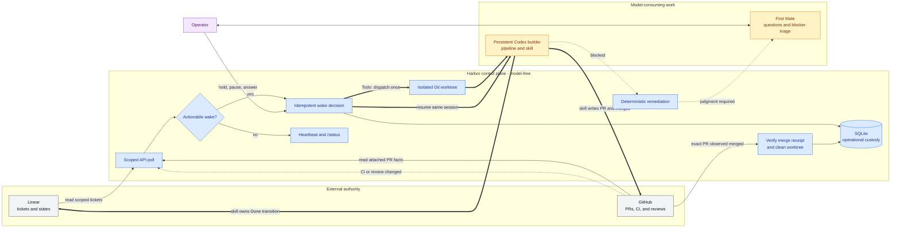

# Harbor

Harbor is a calm, deterministic supervisor for one explicitly configured
project at a time. It
polls Linear and GitHub without making model calls, dispatches a configured
delivery skill in an isolated worktree, keeps the same builder session across
re-engagement, and gives the operator a First Mate console in the same
terminal.

The boundary is deliberate:

> The skill decides. Harbor watches, wakes, unblocks, and reports.

The skill is a Markdown-controlled prompt. A team can replace
`/work-pipeline` with its own ticket-to-PR instructions without changing
Harbor or adding a Harbor-specific implementation role.

## Why Harbor exists

Harbor is inspired by Symphony's issue-to-workspace orchestration and
Firstmate's operator-oriented supervision. It addresses two practical
constraints in long-running delivery workflows:

- **Monitoring should be cheap.** Linear and GitHub polling, snapshot
  comparison, wake decisions, heartbeats, and status rendering are ordinary
  deterministic code. A cycle with no actionable Linear or GitHub facts does
  not invoke a model.
- **Delivery policy belongs to the project.** Planning, implementation,
  review, proof, and merge rules vary by repository. Harbor passes the selected
  pipeline document and skill to the builder instead of embedding those rules
  in the supervisor.

Builder and First Mate models, reasoning effort, polling cadence, deadline,
and merge hold are configured in Markdown. The built-in runner uses Codex;
supporting another agent harness requires a runner adapter.

## Manual multi-project setup

Harbor does not currently provide `harbor init`. Each user owns a private
registry and one pipeline document per workflow. The checked-in `projects.md`
and `templates/pipeline.md` files are neutral format examples; Harbor never
uses them as real product configuration.

Create pipelines wherever they make sense for the user or team. A repository-
local `.harbor/pipeline.md` can be shared with that repository; a pipeline in a
private directory can customize one operator's models, commands, and policy.

```bash
mkdir -p "$HOME/.harbor"
mkdir -p "$HOME/Pipelines"
cp templates/pipeline.md "$HOME/Pipelines/sample-project.md"
```

Create `$HOME/.harbor/projects.md` with one row per repository:

```md
| name | repo_path | pipeline_path | linear_project_slug | linear_team | github_repository | base_branch |
| --- | --- | --- | --- | --- | --- | --- |
| SampleProject | ~/Projects/SampleProject | ~/Pipelines/sample-project.md | sample-project-abc123 | SAMPLE | example/SampleProject | main |
| AnotherProject | ~/Projects/AnotherProject | ~/Projects/AnotherProject/.harbor/pipeline.md | another-project-def456 | OTHER | example/AnotherProject | main |
```

Set credentials and select the private registry. Credentials stay in the
environment and must never be written into either Markdown file.

```bash
export HARBOR_PROJECTS_FILE="$HOME/.harbor/projects.md"
export LINEAR_API_KEY="<linear-api-key>"
export GH_TOKEN="<github-token>" # only when GitHub facts are configured
```

Each named project has separate repository, pipeline, Linear scope, GitHub
facts, worktree root, and SQLite custody. `linear_projects` widens one named
project's Linear scope; it is not a way to combine unrelated repositories or
workflows. Run one Harbor process per named repository.

## Verify and start

From the Harbor checkout:

```bash
cd ~/Projects/harbor
uv sync
uv run harbor doctor SampleProject
uv run harbor start SampleProject
```

The selected private registry resolves `SampleProject` to its repository, Linear project, GitHub
repository, base branch, and live pipeline document. `doctor` verifies the
Linear connection and that the configured project scope exists. `start` then
opens the `first-mate>` prompt, starts model-free polling, and schedules any
eligible builder dispatch in the background so the prompt remains usable
while an agent works.

Linear and GitHub API credentials are external-service credentials, not model
calls. Linear uses `LINEAR_API_KEY` or `HARBOR_LINEAR_API_KEY`; the GitHub
poller uses `GITHUB_TOKEN` or `GH_TOKEN` when GitHub facts are configured.

For a read-only one-cycle check:

```bash
uv run harbor start SampleProject --once
uv run harbor start SampleProject --shadow
uv run harbor facts SampleProject --json
uv run harbor status SampleProject --json
```

`--shadow` computes wake decisions and prints `WOULD WAKE` lines without
dispatching, queuing, or writing Linear/GitHub. `facts` performs the read-only
PR-facts query; `status` reads the local runtime ledger.

## Same-terminal First Mate workflow

There is no `harbor ask` or project-name prefix for questions. Once
`harbor start SampleProject` is running, type a plain question directly. Slash
commands are deterministic and do not invoke a model; plain text sends one
question to the configured First Mate model with the same fresh digest shown
by `/status`.

```text
first-mate> /status
Harbor: RUNNING · SampleProject · Linear healthy
SAMPLE-33  Done  ...  PR #226
Run harbor-SampleProject-SAMPLE-33-builder  builder  completed  waiting on none  outcome=merged  pr_url=https://github.com/example/SampleProject/pull/226

first-mate> What is the fleet waiting on?
<one Terra answer based on the refreshed fleet digest>

first-mate> /hold on SAMPLE-42
Harbor: HOLD ON · SAMPLE-42

first-mate> /hold off SAMPLE-42
Harbor: HOLD OFF · SAMPLE-42

first-mate> /pause Stopping for the evening
Harbor: PAUSED · Stopping for the evening

first-mate> /resume
Harbor: RUNNING

first-mate> /exit
Harbor: STOPPED
```

The commands are:

| Command | Effect |
| --- | --- |
| `/status` | Render the deterministic fleet digest: Linear tickets, PR/CI/review facts, builder runs, outcomes, and escalations. Zero model calls. |
| `/hold on/off <ticket>` | Change the durable merge hold for exactly one observed ticket. This does not pause polling or other agents. |
| `/pause [reason]` | Pause the whole supervisor: no new dispatches or resumes; a running builder is allowed to finish and its deadline is suspended. |
| `/resume` | Re-enable dispatch/resume, restart deadline accounting, and perform a fresh poll. |
| `/answer <escalation-id> <answer>` | Record an operator decision and attempt to resume the retained builder session. |
| `/kill [run-id]` | Request termination through an installed process-owner hook; reports when no hook is available. |
| `/exit` | Stop polling, heartbeat, and active dispatches, then close the foreground console. It does not create a replacement agent. |
| `/help` | Print the command list. |

`/hold` is intentionally not an alias for `/pause`: a hold is per-ticket
merge policy stored in Harbor's ledger, while pause is a whole-supervisor
lifecycle control. `hold_all`/`hold` in `pipeline.md` supplies the default
shadow policy for newly observed work; the command changes one ticket's local
operational flag.

## Architecture

The blue nodes are Harbor's deterministic control plane. The amber nodes are
the model-consuming work. Linear and GitHub remain external authorities;
SQLite stores operational custody and receipts, not a second copy of project
truth.



Harbor's GitHub client is query-only. GitHub mutations in the diagram belong
to the builder acting under the configured skill. Harbor itself may make only
narrow, cited Linear progress or escalation writes; the skill owns the normal
delivery workflow and terminal `Done` transition.

## Example workflow: Linear to Done

1. Harbor polls the named project's configured Linear scope and active states.
   `Backlog` is excluded.
2. It reads GitHub facts only for PRs attached to those active Linear tickets.
3. Harbor hashes the normalized Linear snapshot, then evaluates current GitHub
   facts even when that Linear snapshot is unchanged. If neither source yields
   an actionable wake, the cycle ends without a model call.
4. An eligible, unblocked `Todo` ticket produces one idempotent build wake.
5. Harbor creates an isolated worktree from the configured base branch and
   starts the configured builder with the ticket facts and raw pipeline
   document.
6. The delivery skill owns planning, implementation, tests, commits, the PR,
   review responses, proof, risk policy, and the merge decision.
7. When CI or review facts change, Harbor resumes the retained builder session
   instead of creating a replacement agent.
8. After GitHub reports the exact PR as merged, Harbor records the merge receipt
   and only then removes the ticket worktree.

If a builder is blocked, Harbor first tries deterministic remediation. A
remaining blocker goes to the configured First Mate for cited triage, then to
the operator when judgment or authority is required. An operator answer resumes
the retained builder session when it is still available.

## Token efficiency

| Path | Model usage | Current behavior |
| --- | --- | --- |
| Linear/GitHub polling | None | Ordinary API calls scoped to configured tickets and attached PRs. |
| Snapshot, wake, heartbeat, and `/status` | None | Deterministic code; cycles with no actionable wake do not invoke an LLM. |
| SQLite receipts and restart recovery | None | Retains ownership, idempotency, run, session, escalation, and merge evidence. |
| Builder | Yes | Runs the configured delivery pipeline only after an actionable wake. |
| First Mate | Yes, on demand | Invoked for a plain-language question or blocker triage, not routine polling. |

Same-session re-engagement preserves the builder's context instead of silently
starting a replacement. Harbor can record runner-reported cost, but it does not
enforce a per-task token limit. `deadline_minutes` is a time boundary, not a
token budget.

## What each developer can swap

| Developer choice | Change now | Harbor keeps owning | Current limit |
| --- | --- | --- | --- |
| Project identity | Private registry via `HARBOR_PROJECTS_FILE`; repository, pipeline, Linear scope, GitHub repository, and base branch | Polling, worktree isolation, and custody | No `harbor init` command yet |
| Builder and First Mate models | Model and reasoning settings in `pipeline.md` | Wake lifecycle and same-session resume | Available models depend on the runner |
| Delivery flow | Replace `skill: /work-pipeline` and its surrounding Markdown instructions | Scheduling, liveness, escalation, receipts, and worktree lifecycle | The runner environment must already provide the replacement skill |
| Supervision policy | Poll and dispatch states, cadence, deadline, hold, checks, worktree root, and rework cap | Idempotency and safety boundaries | A deadline is not a token budget |
| Execution harness | Implement and inject another runner | Worktree dispatch and run lifecycle | Codex is the only built-in production runner |
| Tracker | Extend the client and poller boundary | Snapshot, wake, and receipt model | Linear is the only built-in tracker |

Harbor treats `skill` and the rest of `pipeline.md` as workflow data. Replacing
the skill does not change Harbor's supervision contract: the workflow receives
the same ticket facts, worktree, wake and re-engagement lifecycle, and status
context.

### Heartbeat

The heartbeat is an independent, model-free loop. `heartbeat_seconds` defaults
to 60 and is configurable in the pipeline document. Each event carries the
project, lifecycle, health, publication time, snapshot hash, last observed
activity, and idle seconds. The terminal prints a heartbeat line; `/status`
shows the detailed run and waiting state when you need to know what the agent
is doing. Heartbeats do not poll an LLM, alter Linear/GitHub, or make wake
decisions.

### External authority and local custody

Linear and GitHub remain authoritative for external state:

- Linear owns ticket state, ticket comments, project scope, and ticket-to-PR
  attachments. The builder skill owns normal progress and the terminal `Done`
  transition after a verified merge. Harbor's unblock ladder may write a
  cited progress comment and park an owned ticket in `Blocked` or `Human
  Review`; it never writes `Done`.
- GitHub owns PR state, head SHA, checks, reviews, review threads, comments,
  and merge state. Harbor's GitHub client is query-only. The builder skill is
  the only component that posts PR comments, addresses review comments,
  computes/writes risk proof, or merges.

SQLite at `~/.harbor/harbor.db` is runtime custody, not a competing source of
truth. It records ownership, idempotency keys, snapshots/events, run/session
identity, liveness, review-thread observations, blocker/escalation history,
resolutions, and merge/cleanup receipts. This is what lets Harbor resume the
same builder and avoid duplicate dispatches after a restart. A fresh poll
reconciles external state; local rows never override Linear or GitHub.

## Configuration

Copy the neutral template to the pipeline path named in the private registry:

```bash
cp templates/pipeline.md "$HOME/Pipelines/sample-project.md"
```

To swap a project to a different workflow, update only that project's
`pipeline_path` cell in `$HARBOR_PROJECTS_FILE`, run `harbor doctor <name>`,
then restart that named Harbor process. Existing users keep their private
registry and project-owned pipelines when the Harbor CLI itself is upgraded;
an update changes executable code, not those configuration files.

Edit the Markdown document as data. The important fields are:

```md
## Models
| role | model | reasoning_effort |
| --- | --- | --- |
| builder | gpt-5.6-luna | xhigh |
| firstmate | gpt-5.6-terra | xhigh |

skill: /work-pipeline
heartbeat_seconds: 60
poll_interval_seconds: 60
deadline_minutes: 90
hold: true

linear_project_slug: sample-project-abc123
linear_team: SAMPLE
poll_states: [Todo, In Progress, In Review, Blocked, Human Review]
dispatch_states: [Todo]
base_branch: main
worktree_root: ~/.harbor/worktrees/SampleProject
github_repository: example/SampleProject
required_checks: [CI]
bot_rework_cap: 1
```

Change `skill`, the builder/First Mate models, reasoning effort, heartbeat,
poll interval, scope, or worktree settings in this file. Unknown fields remain
available as skill prompt data. Harbor only parses the operational settings it
needs and keeps the delivery instructions opaque.

## Files and responsibilities

| File/module | Responsibility |
| --- | --- |
| `projects.md` | Human-editable project registry: checkout, pipeline, Linear scope, GitHub repository, and base branch. |
| `templates/pipeline.md` | Starting point for a project's swappable skill/model/heartbeat configuration. |
| `src/harbor/cli.py` | Production composition root and `doctor`, `start`, `status`, `facts`, and `answer` commands. |
| `src/harbor/console.py` | Same-terminal prompt, slash commands, prompt-safe background output, and plain-question routing. |
| `src/harbor/supervisor.py` | Async lifecycle, polling loop, wake scheduling, background dispatch, pause/resume, merge reconciliation, and status assembly. |
| `src/harbor/db.py` | SQLite schema, migrations, WAL, idempotency, runtime custody, and durable receipts. |
| `src/harbor/digest.py` | Pure deterministic formatter shared by `/status` and First Mate prompts. |
| `src/harbor/heartbeat.py` | Configurable model-free liveness/activity events. |
| `src/harbor/first_mate.py` | Read-only ephemeral Terra question/triage invocation. |
| `src/harbor/notify.py` | Operator notifications for escalations and capped rework. |
| `src/harbor/config/projects.py` | Resolve named projects and require the live pipeline document. |
| `src/harbor/config/pipeline.py` | Parse Markdown pipeline settings while retaining skill data as opaque configuration. |
| `src/harbor/config/profile.py` | Parse read-only GitHub/project profile facts used by pollers and event handling. |
| `src/harbor/clients/linear.py` | Async Linear GraphQL reads plus narrow cited blocker/progress writes; rejects terminal `Done` writes. |
| `src/harbor/clients/github.py` | Async query-only GitHub GraphQL client; builds aliased PR queries. |
| `src/harbor/poll/linear_poller.py` | Poll configured Linear projects/states and normalize ticket/attachment/comment facts. |
| `src/harbor/poll/github_poller.py` | Poll only PRs attached to active tickets. |
| `src/harbor/poll/snapshot.py` | Canonical snapshot hashing and changed/unchanged detection. |
| `src/harbor/facts/ci.py` | Required-check and rollup interpretation for display/wake facts. |
| `src/harbor/facts/threads.py` | Review-thread severity, bot, outdated, path, line, and resolution facts. |
| `src/harbor/facts/remediation.py` | Deterministic environment-remediation facts/playbooks for rung 0. |
| `src/harbor/wake.py` | Model-free build/re-engagement decisions, ownership, caps, and idempotency. |
| `src/harbor/reengagement.py` | Turn changed PR/CI facts into a bounded same-session resume instruction. |
| `src/harbor/pr_events.py` | PR-created and external-comment event receipts, risk/comment handoff, and mandatory reply contract. |
| `src/harbor/unblock.py` | Rung 0 remediation, Terra cite-or-escalate, operator parking, and same-session resume. |
| `src/harbor/worktree.py` | Fresh `origin/main` worktrees, disk/lock safety, install, and verified-merge cleanup. |
| `src/harbor/runner/base.py` | Runner lifecycle, deadlines, result normalization, liveness, and orphan handling. |
| `src/harbor/runner/codex.py` | Persistent Luna `codex exec`/`resume` in the isolated worktree. |
| `src/harbor/runner/stream.py` | JSONL event parsing and final run-result extraction. |
| `schemas/run-result.json` | Stable builder final-result contract for status, outcome, blocker, and PR identity. |
| `migrations/` | Additive schema migrations for wake, runner, re-engagement, unblock, PR feedback, and merge receipts. |

## Safety boundaries

- Only `Todo` dispatches by default; `Backlog` is excluded from the Linear
  query.
- Every builder runs in `~/.harbor/wt/<project>/<ticket>` (or configured
  `worktree_root`), never in the operator's checkout.
- A logical run ID and Codex session ID are retained for re-engagement; Harbor
  never silently creates a replacement session for a blocker.
- Harbor observes GitHub and does not mutate it. Risk analysis, PR replies,
  review resolution, and merge are performed by the configured skill.
- A claimed merge is not enough to delete a worktree. Harbor first observes
  the exact PR as merged, persists a merge receipt, and only then removes the
  local worktree. Unobserved claims remain fail-closed.
- Pause stops new dispatch/resume and suspends deadlines; it does not erase
  the ledger or pretend the builder completed.

## Test fixtures and external proof

The automated suite uses offline SampleProject fixtures. They never connect to
a maintainer checkout, Linear project, or GitHub repository and never affect
user configuration. Passing tests prove deterministic behavior; authorized
live canaries separately prove external Linear-to-merge operation.
