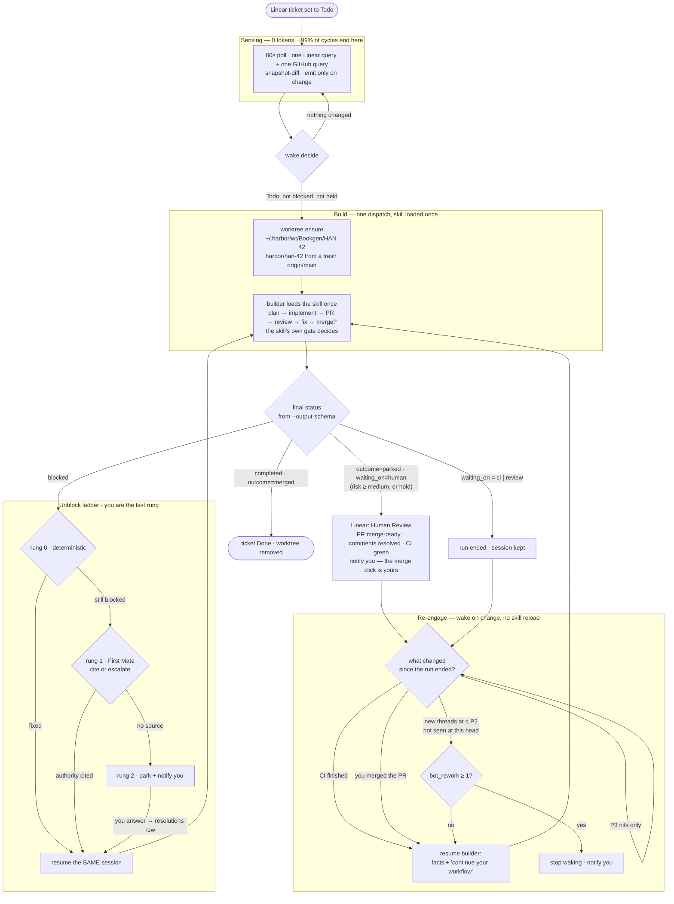
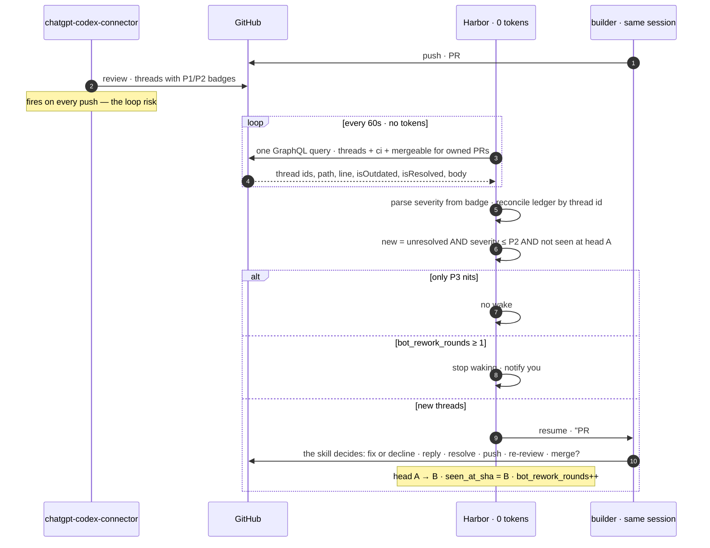
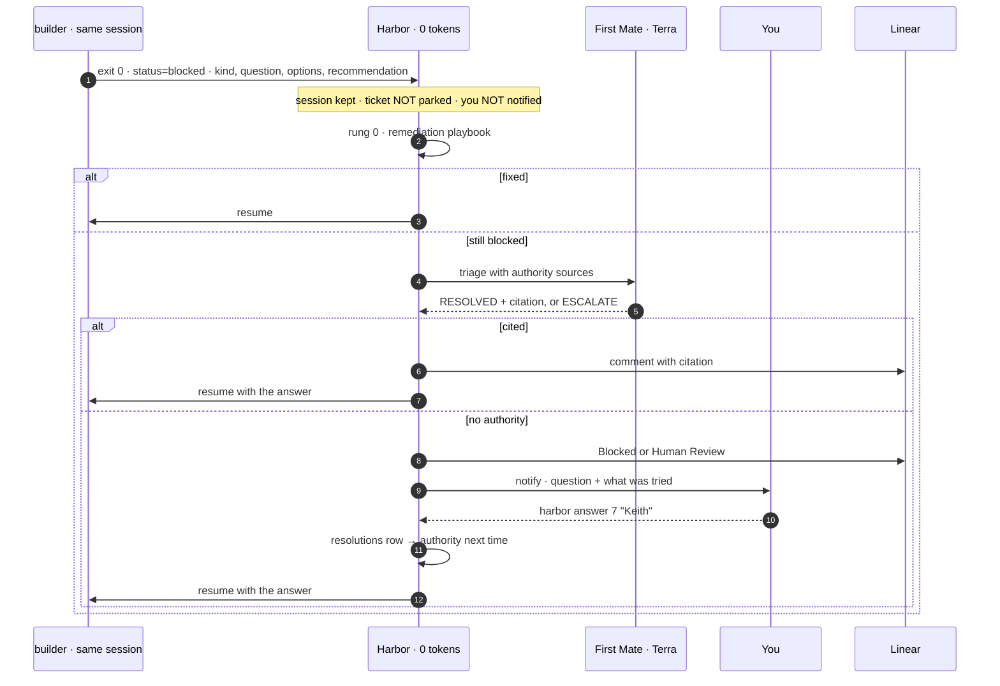

# Harbor MVP — a First Mate console that runs a pluggable skill and stays out of its way

## Context

You want Linear tickets worked by agents, tracked through GitHub, and merged when low-risk —
without paying tokens to *watch*, with a first mate you can talk to, that tells you things, and
that a stuck agent can reach.

Rejected: **firstmate** (~167 bash scripts over tmux; its whole GitHub tracker is one
`gh pr view --json state` that detects only `merged`) and **symphony** (Elixir; drops tickets that
leave `active_states`, so `Human Review` is a black hole). Neither runs today.

**Organizing principle:**

> **The skill decides. Harbor watches, wakes, unblocks, and reports.**

`/work-pipeline` — or whatever skill a developer swaps in — owns the whole delivery loop for a
ticket: plan, implement, review, fix, and the risk-gated merge. Harbor makes **no assumptions
about the skill's internals** and never gates a merge. Harbor owns *time* (when an agent runs),
*supervision* (is it alive, what has it cost), *unblocking* (the ladder), and *reporting*. That
split is what makes the skill swappable and keeps the token bill to the work itself.

### Measured on your real data (read-only queries run during planning)

| Call | Covers | Payload | Tokens |
|---|---|---|---|
| One Linear GraphQL POST | all 4 active HAN issues + state, labels, attachments, comments, relations | **4.9 KB**, `x-complexity: 45` | 0 |
| One GitHub GraphQL query | the ≤5 PRs attached to active tickets — mergeable, CI rollup, review threads | **< 5 KB** | 0 |

At 60s: 2,700 complexity/hr against Linear's 3,000,000 (0.09%); ~120 GitHub calls/hr against
5,000. Agent-driven polling would cost ~2–3M tokens/day to learn nothing changed.

### MVP scope

- **One project:** Bookgen / Linear `hanzireader` (team `HAN`). One ticket in flight.
- **Dispatch trigger: `Todo` only.** `Backlog` is never polled and never dispatched.
- Harbor *observes* `In Progress`, `In Review`, `Blocked`, `Human Review` for tickets it started.
  Pre-existing tickets are shown as `(observed)` and never woken.
- Agents work in a **git worktree**, never in your main checkout.
- **Shadow mode first:** every ticket carries a `hold`, which any reasonable skill honours as
  "don't merge" (`work-pipeline` §6 checks it explicitly). Lift it when you trust the loop.

```python
POLL_STATES     = ["Todo", "In Progress", "In Review", "Blocked", "Human Review"]
DISPATCH_STATES = ["Todo"]
```

### Day-one board

| Linear | State | PR | CI | Unresolved (all `chatgpt-codex-connector`) |
|---|---|---|---|---|
| HAN-29 | In Progress | #221 | SUCCESS | 4 — 3 of them `isOutdated` |
| HAN-16 | In Progress | #219 **and** #220 | SUCCESS | 2×P2, 2×P2 |
| HAN-17 | In Review | #218 | SUCCESS | 1×P1 |
| HAN-7 | In Progress (15 comments) | #217 | **FAILURE** | 0 |

All four are `(observed)` on day one. Harbor touches none of them.

---

# 1. Architecture

```
┌──────────────────────────────────────────────────────────────────────────┐
│  harbor start Bookgen        ONE foreground asyncio process              │
│                                                                          │
│  ┌────────────┐   ┌──────────────┐   ┌───────────┐   ┌────────────────┐  │
│  │  console   │   │  supervisor  │   │  pollers  │   │   runner       │  │
│  │ prompt_    │   │  wake loop   │   │  linear   │   │  codex exec    │  │
│  │ toolkit    │   │  60s cycle   │   │  github   │   │  in a worktree │  │
│  └─────┬──────┘   └──────┬───────┘   └─────┬─────┘   └───────┬────────┘  │
│        └─────────────────┴────────┬────────┴─────────────────┘           │
│                                   ▼                                      │
│                            ┌─────────────┐                               │
│                            │  harbor.db  │  runtime state only           │
│                            └─────────────┘                               │
└──────────────────────────────────────────────────────────────────────────┘
         │                            │                         │
    you type                    0 tokens                   the only tokens
         ▼                            ▼                         ▼
   First Mate (1 call)      Linear + GitHub API          the builder (runs the skill)
```

**Two phases, one agent.** The builder is a single persistent session per ticket that runs the
skill end to end. The phases differ only in *who decides when it runs*:

```
BUILD ─ Todo → the skill's run ends ─────── one dispatch, skill loaded once
   Harbor starts the builder in a fresh worktree and gets out of the way.
   The skill plans, implements, opens the PR, reviews, fixes, and merges if
   its own gate says low risk. If it must wait (CI, comments, a human), the
   run ends and says what it is waiting on.

RE-ENGAGE ─ run ended waiting ─────────── wake on change, no skill reload
   Harbor polls for free. When the thing the builder was waiting on changes —
   CI finished, new review threads, your answer — Harbor resumes the SAME
   session with the facts. The skill continues its own workflow from there.
```

Harbor never tells the skill *what* to do next, only *that something changed*. The instruction
is the same shape for every skill: the ticket, the PR, and what changed since the last run.

### The merge rule — owned by the implementer agent, not Harbor

"The skill" throughout this plan means the **implementer agent**: the builder session running
`/work-pipeline` (internally, its Luna). It — and only it — decides the merge:

| Risk (per the skill's own classification against `AGENTS.md`) | Comments | Then the implementer… | Linear |
|---|---|---|---|
| `low` | all resolved, CI green, review approved, no `hold` | **squash-merges**, sets `Done`, reports `outcome=merged` | `Done` |
| `low` | same, but `hold` is on | parks — `outcome=parked`, `waiting_on=human` | `Human Review` |
| `medium` / `high` | **resolves every comment first**, gets CI green and review approved | parks a merge-ready PR — `outcome=parked`, `waiting_on=human` | `Human Review` |

A ticket in `Human Review` is one where *all the work is done* and only the merge click is yours.
When you merge it, Harbor sees the PR flip to `merged` on an owned ticket whose run ended
`waiting_on=human`, and re-engages the builder with that fact; the skill then finishes its own
workflow — `Done`, worktree removed. Harbor still never merges, never moves a ticket to `Done`,
and never judges risk.

## 1.1 Ticket lifecycle



Tokens are spent in exactly two places: `B` and `RUNG1`. The poll, the diff, the wake decision,
and the caps are Python.

## 1.2 Re-engagement — how a bot comment reaches the agent



Harbor never interprets the threads. It hands the builder the facts and the skill does what it
does — `work-pipeline` §5 sends findings to Luna and re-reviews with the same Sol. A different
skill may do something else; Harbor doesn't care.

### What the connector actually posts (live from #221 at `83c065d5`)

| Thread id | path | line | outdated | severity |
|---|---|---|---|---|
| `PRRT_kwDORf1dpc6d_ILg` | `docs/specs/proof/han-29/live-web.md` | `null` | **true** | P1 |
| `PRRT_kwDORf1dpc6d_ILn` | `apps/mobile/app/book/[id]/read.tsx` | 648 | false | P2 |
| `PRRT_kwDORf1dpc6d_ILt` | `apps/mobile/app/book/[id]/read.tsx` | `null` | **true** | P2 |
| `PRRT_kwDORf1dpc6d_ILu` | `packages/core/src/dictionary/index.ts` | `null` | **true** | P2 |

Every body opens `**<sub><sub></sub></sub> Title**`,
so severity is `re.search(r"/badge/(P\d)-", body)` — free. Three of four are `isOutdated` with
`line: null`; Harbor passes `path` and the fact that it's outdated so the skill can adjudicate
rather than search for a line that no longer exists.

### The bound

```python
new = [t for t in threads
       if not t.resolved and t.severity <= "P2" and t.seen_at_sha != head]
if not new:                       return None          # nothing to say
if bot_rework_rounds >= 1:        return STOP_AND_NOTIFY
return Wake(resume=builder.run_id, facts=new)          # bot_rework_rounds++ on push
```

The fixed point is *code changed*, not *comment appeared*: a thread is offered to the builder once
per head. Without that, agent pushes → bot posts → Harbor wakes → agent pushes, forever.

## 1.3 Flow A — Linear status in, dispatch out

**Two halves of the First Mate.** Dispatch is the half with no model in it.

| Half | File | Runs | Cost |
|---|---|---|---|
| Deterministic — poll, decide, dispatch, supervise | `supervisor.py` | every 60s | **0** |
| Conversational — answer you, map prose to actions | `first_mate.py` | when you type | 1 call |

```python
# supervisor.py
async def tick(self):
    tickets = await self.linear.poll()
    prs     = await self.github.poll(owned_pr_numbers())
    for t in tickets:
        w = wake.decide(t, facts(t, prs))
        if w: await self.dispatch(w)
```

**Auth** (`clients/linear.py`) — env → Keychain `harbor-linear` → `zsh -ic` (**not** `-lc`;
verified: the key is exported in `~/.zshrc`, which a login shell doesn't source). Header is a raw
token, not `Bearer`.

**One query** (`poll/linear_poller.py`) — validated at 4.9 KB / complexity 45. `$states` is
`POLL_STATES`, so Backlog is never fetched:

```graphql
query HarborIssues($slug: String!, $states: [String!]!) {
  issues(filter: {project: {slugId: {eq: $slug}}, state: {name: {in: $states}}}, first: 50) {
    nodes {
      id identifier title url updatedAt branchName
      state { name type }
      attachments(first: 10) { nodes { url sourceType } }
      comments(first: 20) { nodes { id createdAt body } }
      inverseRelations(first: 20) { nodes { type issue { identifier state { type } } } }
    }
  }
}
```

`attachments[sourceType == "github"]` is the ticket→PR join — already populated by the
`linear-code` bot. The GitHub poller queries **only those PR numbers**, aliased in one request,
so the ~16 legacy PRs never enter the system and no label is needed.

**Emit only on change** (`poll/snapshot.py`) — `sha256(canonical_json(resp))`; equal to last →
return nothing. This is the zero-token path.

**Decide** (`wake.py`):

```python
def decide(t, f):
    if db.active_run(t.identifier):                      return None
    if t.state in DISPATCH_STATES and not t.blocked_by:
        db.mark_owned(t.identifier)
        return Wake(action="build", idem_key=f"{t.identifier}@build",
                    instruction=briefs.build(t))         # hold status included
    if t.owned and (r := db.last_run(t.identifier)) and r.waiting_on:
        return reengage(t, f, r)                         # §1.2
    return None                                          # observed only
```

`idem_key` has a `UNIQUE` partial index over live statuses — the database refuses a duplicate,
not application logic. The build key carries **no timestamp**: Harbor's own Linear comments change
`updatedAt`, and a key that moved with it would defeat the index.

**Worktree, then spawn** (`worktree.py`, `runner/codex.py`). Your main checkout is on
`docs/d103-manual-deploy` and dirty, with 20 worktrees and 380 branches — the base comes from
config and a fresh fetch, never from what's checked out.

```python
path = ~/.harbor/wt/<repo>/<TICKET>
with flock(repo/.git/harbor.lock):
    if free_disk_gb() < 25: raise DiskFloor()
    git worktree prune; git fetch origin main
    git worktree add -B harbor/<ticket> <path> origin/main
pnpm install                       # hardlinks from the global store, not a 2 GB copy

run_id = str(uuid4()); db.insert_run(run_id, ..., status="running", deadline_at=now()+cfg.deadline)
proc = await asyncio.create_subprocess_exec(
    "codex","exec","-m",model,"-C",path,"-s","workspace-write",
    "--output-schema",SCHEMA,"--json", stdin=brief, start_new_session=True,
    env={**os.environ, "GIT_CEILING_DIRECTORIES": path.parent})
async for ev in stream.parse(proc.stdout): db.touch_activity(run_id, ev)   # liveness for free
```

The worktree lives as long as the ticket: removed on merge, kept while parked or waiting.

## 1.4 Flow B — blocked, unblocked, resumed

**Detection without the skill's cooperation.** `--output-schema` is a *runner* flag, so it shapes
the final message whatever the skill says:

```python
FINAL_SCHEMA = {
  "required": ["status", "summary"],
  "properties": {
    "status":     {"enum": ["completed", "waiting", "blocked", "failed"]},
    "outcome":    {"enum": ["merged", "pr_open", "parked", "no_pr"]},  # parked ⇒ Linear Human Review, merge-ready
    "waiting_on": {"enum": ["ci", "review", "human", "none"]},
    "pr_url":     {"type": "string"},
    "summary":    {"type": "string"},
    "next_action":{"type": "string"},
    "blocker": {"type": ["object","null"], "properties": {
        "kind": {"enum": ["product_decision","env_blocker","ambiguous_ac",
                          "missing_proof_capability","conflicting_instruction"]},
        "question": {"type":"string"}, "options": {"type":"array"},
        "recommendation": {"type":"string"}, "evidence": {"type":"string"}}}}}
```

`waiting` is the status that makes re-engagement work: the skill reached a point it can't pass in
a non-interactive run (CI not finished, review comments outstanding) and says so. Corroborated by
artifact checks — `completed` with no PR and no commits is reclassified `blocked`.

**Record, don't park yet.** The run has exited 0 with its session kept. Nothing is moved, nobody
is notified, until the ladder has failed.

**The ladder** (`unblock.py`):

```
rung 0  deterministic remediation ── 0 tokens ── pnpm install · adb start-server · retry
rung 1  First Mate triage ─────────── 1 call ──── cite or escalate
rung 2  you ───────────────────────── park ─────── only when 0 and 1 fail
```

Rung 1 works under one rule: **cite or escalate**. It may resolve a blocker only by pointing at
an authority that already answers it — in precedence order: the ticket; `AGENTS.md`;
`docs/ProductSpec.md`; `docs/DISCOVERIES.md`; repo precedent; **Harbor's own `resolutions`
table** (you answered this before); active policies. Confidence is not authority. It never
resolves anything that touches `protected_paths` or a genuinely new product decision. Capped at 2
attempts per ticket; every resolution posts its citation and shows in `/status` with `[override]`.

**Park and notify, only now** — `Blocked` for environment, `Human Review` for a decision; the
notification says what was already tried.

**You answer** — in the console, `harbor answer <id> <text>`, or `/harbor answer …` as a Linear
comment. Exact option matches cost 0; free prose costs one small mapping call. Every answer
writes a `resolutions` row, so the next occurrence resolves at rung 1 without you.

**Resume the same session** — shared by every rung, and by re-engagement:

```python
["codex","exec","resume", run_id, prompt, "--json","--output-schema",SCHEMA]
```

Same session ⇒ the builder still holds the repo it explored; the continuation is a cache hit.
If the session can't be resumed, Harbor says so in Linear and asks you — it never silently
creates a replacement.



---

# 2. How you use it

```bash
cd ~/Projects/harbor && uv sync
uv run harbor doctor Bookgen
uv run harbor start Bookgen
```

```text
$ harbor start Bookgen
Harbor: RUNNING · First Mate gpt-5.6-terra · Bookgen · Linear ✓ · GitHub ✓
Scope: Todo → dispatch · Backlog ignored · hold_all: on (shadow mode)

first-mate> /status
HAN-42  PR #224 @a1b2c3d  CI green  2 new threads (P2,P2)  → waking builder
        worktree ~/.harbor/wt/Bookgen/HAN-42 · builder idle 3m · $4.10 · waiting_on=review
        auto-unblocked 12m ago — cited resolutions #3   [override]
HAN-16  (observed)  PR #220  CI green  2 threads
HAN-7   (observed)  PR #217  CI RED
HAN-29  (observed)  PR #221  CI green  4 threads (3 outdated)
Escalations: none          Spend today: $6.82

first-mate> Why hasn't HAN-42 merged?
It's on hold — shadow mode is on, so the implementer resolved all four threads, got
CI green and review approved, then parked it in Human Review instead of merging.
It's merge-ready; lift with /hold off HAN-42, or merge it yourself and I'll finish up.

first-mate> /pause Stopping for the evening
```

Console: `/help /status /hold on|off <ticket> /pause /resume /kill /exit`. Everything else goes
to the First Mate.

---

# 3. Files

```
~/Projects/harbor/src/harbor/
├── cli.py            doctor · start · answer · status
├── console.py        prompt_toolkit loop, slash commands, event redraw
├── supervisor.py     60s cycle: poll → facts → wake → dispatch · pause suspends deadlines
├── db.py             schema, single-writer task, WAL
├── digest.py         ONE digest for /status and the First Mate
├── notify.py         osascript → Notification Center
├── worktree.py       create · pnpm install · confine · remove on merge
├── wake.py           build dispatch + re-engagement decision + caps
├── unblock.py        rung 0/1/2
├── first_mate.py     codex exec -m terra -s read-only --ephemeral · digest + question
├── config/           projects.py · pipeline.py · profile.py
├── clients/          linear.py (reads + Linear writes) · github.py (reads only)
├── poll/             linear_poller.py · github_poller.py · snapshot.py
├── facts/            ci.py · threads.py · remediation.py
└── runner/           base.py · codex.py · stream.py
```

Gone relative to earlier drafts, because the skill owns them: `gate.py`, `facts/risk.py`,
`facts/proof.py`, a reviewer role, a `merges` table, `runner/claude.py` (no MVP role uses it).

**Nothing in Harbor imports a skill or names one except as a config string.** Harbor never
performs a GitHub mutation — the builder does all of them, per its skill.

---

# 4. Data shapes

```python
Ticket  = {"identifier","id","title","state","branch_name","pr_urls","comment_ids","blocked_by",
           "owned","hold"}
PRFacts = {"number","head_sha","mergeable","merged",
           "ci":{"state":"green|red|pending|absent","required_seen":[...]},
           "threads":[{"id","author","is_bot","severity","resolved","outdated","path","line",
                       "seen_at_sha"}]}
Wake    = {"ticket","action":"build|reengage","resume":"<run_id|None>",
           "instruction":"<~1 KB>","idem_key"}
RunResult = {"run_id","status","cost_usd","final":{...FINAL_SCHEMA...}}
```

CI is `green` only when the **named** required checks are present *and* `SUCCESS`. A `null`
rollup is `absent`, never green — you have an open PR titled *"manual deploy path when Actions is
billing-blocked"*, so this case is real. Harbor uses CI only as a wake trigger and a display fact;
the skill applies its own gate.

**Harbor must not read its own writes.** Every Linear comment on HAN-7 is authored `keithlee002`,
`botActor` null, and HAN-7 already has two duplicate *"Applied… PR #217…"* comments a minute apart.
Record every comment id Harbor creates; dedupe on `(issue_id, sha256(body))` before POST.

---

# 5. Build phases

Each phase ends with proof under `~/.harbor/proof/phase-N/`. Tests are necessary, never
sufficient.

## Phase 1 — Console + Linear poller

**Files:** `cli.py`, `console.py`, `supervisor.py`, `db.py`, `config/projects.py`,
`clients/linear.py`, `poll/linear_poller.py`, `poll/snapshot.py`

| | Acceptance criteria |
|---|---|
| AC-1 | `harbor start Bookgen` opens `first-mate>` and reports Linear health |
| AC-2 | `/status` lists the four live HAN tickets with true states, tagged `(observed)` |
| AC-3 | `Backlog` never appears |
| AC-4 | An unchanged cycle writes **zero** `events` rows |
| AC-5 | Background output does not corrupt a partially typed line |
| AC-6 | Zero LLM calls exist |
| AC-7 | `/pause`, `/resume`, `/exit` work with no agents |

**Tests**
```bash
uv run harbor doctor Bookgen && uv run harbor start Bookgen
sqlite3 ~/.harbor/harbor.db "select count(*) from events where at > datetime('now','-3 minutes')"  # 0
pytest tests/test_poller_states.py
grep -rniE 'anthropic|openai|codex' src/harbor/ | grep -v runner/    # empty
```

**Proof** — `/status` screenshot beside a same-minute Linear screenshot; `events` count before and
after 3 idle minutes; asciinema of typing through a background event; the empty `grep`.

## Phase 2 — GitHub poller + facts

**Files:** `clients/github.py`, `poll/github_poller.py`, `facts/ci.py`, `facts/threads.py`,
`config/profile.py`

| | Acceptance criteria |
|---|---|
| AC-1 | One aliased query returns only the PRs attached to active tickets — the ~16 legacy PRs never appear |
| AC-2 | Each thread carries `severity`, `is_bot`, `outdated`, `path`, `line`; outdated threads keep `path` with `line: null` |
| AC-3 | CI is `green` only when named required checks are present and `SUCCESS`; `null` rollup → `absent` |
| AC-4 | Still zero LLM calls |

**Tests**
```bash
uv run harbor facts Bookgen --json > /tmp/facts.json
jq 'length' /tmp/facts.json                                   # ≤ 5, not 22
jq '.[]|select(.number==217)|.ci.state' /tmp/facts.json      # "red"
jq '.[]|select(.number==221)|[(.threads|length),([.threads[].severity]|sort),([.threads[]|select(.outdated)]|length)]' /tmp/facts.json
   # [4,["P1","P2","P2","P2"],3]
pytest tests/test_ci.py tests/test_threads.py
```

**Proof** — `/tmp/facts.json` plus a GitHub screenshot of #221 showing the same four threads; the
`jq` outputs; the `null`-rollup fixture assertion.

## Phase 3 — Wake decisions, shadow mode

**Files:** `wake.py`, `db.py` (+ `prs`, `review_threads`, `comment_receipts`)

| | Acceptance criteria |
|---|---|
| AC-1 | First start against the live board: **zero** WOULD WAKE; all four tickets `(observed)` |
| AC-2 | A fixture `Todo` ticket → WOULD WAKE `build`, `idem_key == "<id>@build"` |
| AC-3 | Two consecutive cycles → zero duplicate rows |
| AC-4 | Posting a Linear comment on a Todo ticket with a live build row inserts zero rows |
| AC-5 | Fixture: run ended `waiting_on=review`, 2 new P2 threads → WOULD WAKE `reengage` |
| AC-6 | Same fixture after one push and new bot threads → `bot_rework_rounds == 1` → STOP + notify |
| AC-7 | Fixture: only P3 threads → no wake |
| AC-8 | A Harbor-authored comment id is never treated as new input |
| AC-9 | Nothing dispatched; nothing written to Linear or GitHub |

**Tests**
```bash
uv run harbor start Bookgen --shadow          # prints WOULD WAKE / silent, mutates nothing
pytest tests/test_wake.py                     # table-driven over AC-2..8
```

**Proof** — screenshot of shadow output showing zero wakes on the live board; `diff` of two
consecutive shadow runs (empty); the AC-6 fixture output showing wake → STOP; a write-stubbed run
proving zero POST/PATCH for AC-9.

## Phase 4 — Worktree + runner + one real build, on hold

**Files:** `worktree.py`, `runner/{base,codex,stream}.py`, `db.py` (+ `runs`)

| | Acceptance criteria |
|---|---|
| AC-1 | Worktree at `~/.harbor/wt/Bookgen/<TICKET>` on `harbor/<ticket>` from a fresh `origin/main` |
| AC-2 | **Your main checkout is byte-identical before and after** — branch, HEAD, `git status --porcelain` |
| AC-3 | The agent cannot write outside its worktree |
| AC-4 | A real build of ticket A (§6) with `hold` on ends with a schema-valid final message: `outcome ∈ {pr_open, parked}`, `pr_url` set, PR `OPEN` |
| AC-5 | Liveness comes from the event stream with the skill calling nothing |
| AC-6 | `killpg` reaps the tree — no orphan `node`/`pnpm` |
| AC-7 | Restart mid-run reaps the run; no double dispatch |
| AC-8 | The deadline terminates a run; **pause suspends deadlines** |
| AC-9 | Dispatch refuses below 25 GB free |

**Tests**
```bash
cd ~/Projects/Bookgen && git rev-parse HEAD > /tmp/before && git status --porcelain > /tmp/bs
uv run harbor start Bookgen            # with ticket A in Todo and hold_all: true
git rev-parse HEAD > /tmp/after && diff /tmp/before /tmp/after && git status --porcelain | diff /tmp/bs -
git worktree list
pytest tests/test_worktree.py tests/test_runner.py
```

**Proof** — `git worktree list`; the two empty `diff`s (AC-2 is load-bearing — your checkout is
on a dirty `docs/d103-manual-deploy`; prove it stayed that way); the final-message JSON and the
open PR; `runs.cost_usd` beside the harness's own figure; `ps` before/after `killpg`.

## Phase 5 — First Mate

**Files:** `digest.py`, `first_mate.py`, `notify.py`

| | Acceptance criteria |
|---|---|
| AC-1 | `/status` makes **zero** LLM calls; a plain question makes **exactly one** |
| AC-2 | Ten idle minutes add zero cost |
| AC-3 | First Mate runs `-s read-only --ephemeral`; a prompt asking it to edit a file fails |
| AC-4 | Ctrl+C during generation cancels only that answer |
| AC-5 | A park fires a Notification Center notification with the literal reason |

**Proof** — screen recording of `/status` → question → answer with `runs` queried around each
(0 / +1 / +0); the notification screenshot; a 10-minute `$0.00` delta.

## Phase 6 — Re-engagement

**Files:** `wake.py` (reengage), `supervisor.py`

| | Acceptance criteria |
|---|---|
| AC-1 | Ticket A's builder ends `waiting_on=review`; connector posts threads; Harbor resumes the **same** `run_id` with the thread facts |
| AC-2 | The resume instruction is < 2 KB, loads no skill, and contains the thread bodies fenced `<untrusted-review-comment>` |
| AC-3 | Outdated threads are passed with `path` and `outdated: true`, not a line |
| AC-4 | After the builder pushes, `seen_at_sha` moves to the new head and `bot_rework_rounds == 1` |
| AC-5 | A second wave of bot threads → no wake, one notification |
| AC-6 | CI finishing on a run that ended `waiting_on=ci` → one resume |
| AC-7 | **Portability:** swap `skill:` for a stub that opens an empty PR and ends `waiting_on=review`; Harbor still re-engages it identically |
| AC-8 | Harbor's outbound log contains zero GitHub mutations across the whole run |

**Proof** — the resume command line showing `exec resume <run_id>`; the instruction with byte
count; the ledger rows before/after the push; the AC-7 stub log; an outbound HTTP log with only
reads.

## Phase 7 — Unblock ladder, then lift the hold

**Files:** `unblock.py`, `facts/remediation.py`, `first_mate.py` (triage), `db.py`
(+ `escalations`, `resolutions`), `cli.py` (+ `answer`)

| | Acceptance criteria |
|---|---|
| AC-1 | Rung 0 fixes a `Cannot find module` block, resumes the same session, notifies nobody |
| AC-2 | Rung 1 resolves a question answered in `DISCOVERIES.md`, citing it, without paging you |
| AC-3 | Rung 1 **refuses** a novel product question and escalates, listing what it searched |
| AC-4 | A resolution with an empty citation is never accepted |
| AC-5 | Same-kind block twice after a rung-1 answer escalates on the third |
| AC-6 | `harbor answer` writes a `resolutions` row; a later identical question resolves at rung 1 |
| AC-7 | **Low risk, `hold` on:** the implementer resolves every comment, gets CI green and review approved, then parks — `outcome=parked`, `waiting_on=human`, Linear `Human Review`, PR open and merge-ready; your notification carries the implementer's reason |
| AC-8 | **Low risk, `hold` off:** the implementer squash-merges — `outcome=merged`, Linear `Done`, worktree removed. Harbor's outbound log shows no mutation |
| AC-9 | **Medium/high risk:** same as AC-7 regardless of `hold` — comments resolved *first*, then `Human Review`. Test with a ticket touching a `protected_paths` file |
| AC-10 | **You merge a `Human Review` PR by hand:** next poll sees `merged` on an owned ticket with `waiting_on=human` → Harbor resumes the builder → the skill sets `Done` and the worktree is removed. Harbor itself never writes `Done` |

**Proof** — `escalations` rows for AC-1/2/3 with `rung_resolved` 0/1/2 and notification counts
0/0/1; the Linear comment with the rung-1 citation; for AC-7/9 a screenshot of the ticket in
`Human Review` beside the PR showing 0 unresolved threads and green checks; for AC-8 the merged PR
and `Done` ticket; for AC-10 the resume command line fired after your manual merge, and the
`Done` transition authored by the builder, not Harbor.

---

# 6. Acceptance test — three tickets, in sequence

Real, low-risk, comment-only tickets against non-protected files, each proving one thing:

| Ticket | File | Proves |
|---|---|---|
| **A** | `src/services/pipeline/outline.ts` — document `OUTLINE_BATCH_SIZE`/`_THRESHOLD` (undocumented today, unlike the constant above them) | build → PR → connector threads → re-engage → the skill fixes, resolves, merges |
| **B** | `src/services/pipeline/concurrency.ts` — header comment naming the owning team | **rung 2**: the answer exists nowhere in the repo; you are paged; same session resumes; merges |
| **C** | `src/services/pipeline/beatJudge.ts` — same header | **rung 1**: cites B's `resolutions` row; you are **not** paged; merges |

```bash
sqlite3 ~/.harbor/harbor.db "delete from resolutions"       # B must start cold
harbor doctor Bookgen && git -C ~/Projects/Bookgen rev-parse HEAD > /tmp/main-before
# hold_all: false for this run only
```

| # | Expected | Evidence |
|---|---|---|
| 1 | Poller picks up A ≤ 60s | `events` row; `/status` → `WAKE build` |
| 2 | Worktree + dispatch | `~/.harbor/wt/Bookgen/HAN-A`; skill loaded **once** in the stream |
| 3 | Escalation *(optional on A; mandatory on B, C)* | `escalations` row; no park, no notification before rung 1 |
| 4 | Ladder | A: whatever occurred; **B: `rung_resolved=2`, 1 notification**; **C: `rung_resolved=1`, citation = B's row, 0 notifications** |
| 5 | Change made | resumed run shares the builder `run_id`; one commit, one file, in the worktree |
| 6 | PR opened, run ends `waiting_on=review` | Linear attachment; `runs.final.waiting_on` |
| 7 | Connector comments | `review_threads` rows with severity |
| 8 | Harbor re-engages | resume command with the same `run_id`; instruction < 2 KB |
| 9 | The skill addresses and resolves them | replies visible; `resolveReviewThread` in the builder's stream, not Harbor's |
| 10 | The skill merges (low risk) | PR `MERGED`; ticket `Done`; worktree gone; `outcome=merged` |

**Determinism.** Step 7 may not fire on a comment-only diff; if no thread appears in 10 minutes,
seed one by hand with a `P2` badge — steps 8–9 must still run. Step 3 is never staged in a brief;
B and C contain a question the repo cannot answer, which real tickets do. If B invents a team name
instead of escalating, that is a finding against `FINAL_SCHEMA` or the skill's own review.

**Abort on:** a duplicate Linear comment; a notification at step 4 on C; an accepted resolution
with no citation; Harbor's outbound log showing a GitHub mutation; `/tmp/main-before` no longer
matching your checkout's HEAD.

**Afterwards:** keep all three comments. Then truncate `resolutions` and re-run a C-shaped
ticket — it must page you again, proving C's citation came from `resolutions` and nowhere else.

---

# 7. Roles, config, state

Harbor holds **two** roles. Whatever the skill spawns internally (`work-pipeline` spawns a Sol
and a Luna via Codex `multi_agent`) is the skill's business; Harbor never has those sessions.

| Harbor role | Model | Sandbox | Session |
|---|---|---|---|
| `builder` | `gpt-5.6-luna` | `workspace-write` in its worktree | persistent per ticket — every resume targets it |
| `firstmate` | `gpt-5.6-terra` | `read-only`, `--ephemeral` | per project |

```md
# .harbor/pipeline.md — Bookgen
## Roles
| builder | gpt-5.6-luna |
| firstmate | gpt-5.6-terra |

## Scope
dispatch_states: [Todo]
poll_states: [Todo, In Progress, In Review, Blocked, Human Review]

## Flow
skill: /work-pipeline          # owns plan → implement → review → fix → risk-gated merge

## Safety
hold_all: true                 # shadow mode: every ticket carries a hold the skill honours
deadline_minutes: 90
bot_rework_cap: 1
```

**Ownership rule, enforced by `doctor`:** `pipeline.md` may reference a `## Pipeline Profile` key
but never restate its value. Risk budget, protected paths, commands, proof requirements live in
`AGENTS.md` and are read by the *skill*, not by Harbor.

**State.** Linear and GitHub are authoritative for ticket and PR state; SQLite for Harbor's
runtime state only.

```
tickets(identifier PK, owned, hold, unblock_attempts, bot_rework_rounds)
prs(number PK, ticket, head_sha, ci_state, merged)
review_threads(id PK, pr, severity, is_bot, outdated, resolved, seen_at_sha)
runs(id PK = session uuid, ticket, role, worktree, pid, pgid, status, waiting_on,
     deadline_at, cost_usd, final_json)
work_queue(id, ticket, action, idem_key UNIQUE where live, attempts)
escalations(id, run_id, kind, question, rung_resolved, citation, answer)
resolutions(id, kind, question_hash, answer, citation, source_ticket)
comment_receipts(issue_id, body_hash PK) · events(append-only)
```

**Pause** = stop dispatching, stop resuming, suspend deadlines. A running builder finishes its
current run. The checkpoint *is* the `runs` row plus the worktree — no agent round-trip.
`/kill <ticket>` exists; "no automatic replacement" is good policy, "no manual kill" is a trap.

**Concurrency.** One asyncio loop, `httpx.AsyncClient`, `asyncio.create_subprocess_exec`, one DB
writer task. A sync HTTP call in a poller freezes the prompt.

---

# 8. Risks

**The merge gate is the skill's, and nothing stands behind it.** Branch protection on Bookgen
returns **403 "Upgrade to GitHub Pro"**, `allow_auto_merge: false`; `main` feeds `deploy-prod` →
hanzireader.com. `work-pipeline` §6 applies the risk tier, but with no branch protection the
skill's judgment is the *only* thing between an agent and production. This is the design you
chose and it's the right one for a pluggable skill — but it means: run shadow mode (`hold_all`)
until the skill's verdicts match yours over several real PRs, and GitHub Pro (~$4/mo) with a
required check is the only structural second line. Harbor cannot be that line without
second-guessing the skill.

**Non-interactive waiting.** A skill that tries to `gh pr checks --watch` holds the run open until
CI finishes — acceptable, bounded by `deadline_minutes`. A skill that ends its run instead must say
`waiting_on=ci`; if it says `completed` with a PR open and nothing merged, Harbor treats it as
`waiting_on=review` and re-engages on the next change. Verify which `work-pipeline` does in Phase 4.

**Terminal-bound.** Closing the console stops supervision; notifications still reach you. Keep
`supervisor.py` and `console.py` separate so a socket seam can be added without a rewrite.

**Disk.** 2 GB `node_modules`, ~90 GB free, 20 worktrees already. pnpm hardlinks; the 25 GB floor
and `git worktree prune` at every create are load-bearing.

## Review log

Two earlier fixes were superseded by the decision that the skill owns the merge:

- *Bound the build at PR-open and detect unauthorized merges* — dropped. That was Harbor assuming
  the skill's structure. Replaced by `hold` (a user-level input the skill already honours) and
  re-engagement on change.
- *Stateless Harbor-dispatched reviewer* — dropped. Review is the skill's. `AGENTS.md`'s
  fresh-context rule is the skill's to honour; a skill that doesn't is a skill bug, not Harbor's.

Surviving from that review: ownership gating (`owned`), agents perform all GitHub mutations, the
build `idem_key` without a timestamp, the three-ticket acceptance test, the PR-number query that
excludes legacy PRs, codex-only runner, pause suspends deadlines.

## Act on separately

A plaintext Linear API key sits in `~/.claude/file-history/a5c3ab2f-…/d03baed6d75325e8@v2`, and
`LINEAR_API_KEY` is plaintext in `~/.zshrc` line 22. I did not read either value. **Rotate the
key**, keep the new one in Keychain only, never in a LaunchAgent plist.

## Open items

- Name/location — assumes `~/Projects/harbor`.
- ~16 legacy open PRs with no Linear ticket: adopt or close. They never enter Harbor.
- Verify in Phase 4 whether `work-pipeline` under `codex exec` waits for CI or ends its run.
